# Лабораторная работа № 2
## HTTP-методы: обработка GET, POST, PUT, DELETE

**Выполнил:** Рудик Аджамян  
**Группа:** ПИЖ-б-о-25-2(1)  
**Уровень:** продвинутый  
**Вариант:** 3  
**Сущность:** товары (`products`)

---

## 1. Цель работы

Освоить обработку HTTP-методов GET, POST, PUT, PATCH и DELETE в Express.js, реализовать CRUD-операции над коллекцией товаров, хранящейся в памяти сервера, добавить валидацию, поиск, сортировку, пагинацию, массовые операции, статистику, поиск связанных товаров, запись запросов в файл и глобальную обработку ошибок.

## 2. Теоретическое обоснование

### 2.1. CRUD

CRUD — это четыре базовые операции над данными:

| Операция | Значение | HTTP-метод | SQL-аналог |
|---|---|---|---|
| Create | Создание | POST | INSERT |
| Read | Чтение | GET | SELECT |
| Update | Обновление | PUT / PATCH | UPDATE |
| Delete | Удаление | DELETE | DELETE |

### 2.2. HTTP-методы

- **GET** — получение данных. Не должен изменять состояние сервера.
- **POST** — создание ресурса. При успешном создании обычно возвращается `201 Created`.
- **PUT** — полное обновление ресурса.
- **PATCH** — частичное обновление: изменяются только переданные поля.
- **DELETE** — удаление ресурса. Успешный ответ может иметь код `200 OK` или `204 No Content`.

GET, PUT и DELETE относятся к идемпотентным методам: повторение одинакового запроса приводит к тому же целевому состоянию ресурса. POST обычно не является идемпотентным.

### 2.3. Коды состояния HTTP

| Код | Название | Применение в работе |
|---|---|---|
| `200 OK` | Успешно | Получение данных, обновление, статистика |
| `201 Created` | Создано | Успешное создание товара |
| `204 No Content` | Нет содержимого | Успешное удаление без тела ответа |
| `400 Bad Request` | Некорректный запрос | Ошибка валидации входных данных |
| `404 Not Found` | Не найдено | Товар или маршрут не существует |
| `500 Internal Server Error` | Внутренняя ошибка сервера | Непредвиденная ошибка приложения |

### 2.4. Хранение данных в памяти

В данной работе товары хранятся в массиве JavaScript. Такой способ прост и не требует настройки базы данных, однако данные теряются после перезапуска сервера и не подходит для промышленного приложения.

## 3. Подготовка проекта

Для создания проекта выполнены команды:

```bash
mkdir lab2-crud
cd lab2-crud
npm init -y
npm install express
npm install --save-dev nodemon
```

В `package.json` необходимо добавить скрипты запуска:

```json
"scripts": {
  "start": "node app.js",
  "dev": "nodemon app.js"
}
```

## 4. Практическая часть: сервер Express

Создан файл `app.js`. В нём реализованы маршруты для получения, создания, обновления и удаления товаров. Также добавлены проверка входных данных, поиск, сортировка, пагинация, PATCH, массовые операции, статистика, связанные товары, логирование в `access.log` и глобальный обработчик ошибок.

### 4.1. Полный код `app.js`

```javascript
const express = require('express');
const fs = require('fs');
const path = require('path');

const app = express();
const port = 3000;

app.use(express.json({ limit: '100kb' }));

// Логирование каждого запроса в файл access.log.
const logPath = path.join(__dirname, 'access.log');

app.use((req, res, next) => {
  const startedAt = new Date().toISOString();

  res.on('finish', () => {
    const line = `${startedAt} ${req.method} ${req.originalUrl} ${res.statusCode}\n`;
    fs.appendFile(logPath, line, (err) => {
      if (err) console.error('Не удалось записать access.log:', err.message);
    });
  });

  next();
});

// Хранилище товаров в памяти.
let products = [
  { id: 1, name: 'Клавиатура', price: 2500, category: 'Периферия', stock: 12 },
  { id: 2, name: 'Мышь', price: 1200, category: 'Периферия', stock: 25 },
  { id: 3, name: 'Монитор', price: 18000, category: 'Электроника', stock: 7 },
  { id: 4, name: 'Наушники', price: 4500, category: 'Аудио', stock: 10 },
  { id: 5, name: 'Колонки', price: 3200, category: 'Аудио', stock: 8 }
];

let nextId = Math.max(...products.map((product) => product.id)) + 1;

function isValidProduct(data, partial = false) {
  if (!data || typeof data !== 'object' || Array.isArray(data)) {
    return 'Тело запроса должно быть JSON-объектом';
  }

  if (!partial || Object.hasOwn(data, 'name')) {
    if (typeof data.name !== 'string' || data.name.trim() === '') {
      return 'Поле name должно быть непустой строкой';
    }
  }

  if (!partial || Object.hasOwn(data, 'price')) {
    if (typeof data.price !== 'number' || !Number.isFinite(data.price) || data.price < 0) {
      return 'Поле price должно быть неотрицательным числом';
    }
  }

  if (!partial || Object.hasOwn(data, 'category')) {
    if (typeof data.category !== 'string' || data.category.trim() === '') {
      return 'Поле category должно быть непустой строкой';
    }
  }

  if (Object.hasOwn(data, 'stock')) {
    if (!Number.isInteger(data.stock) || data.stock < 0) {
      return 'Поле stock должно быть неотрицательным целым числом';
    }
  } else if (!partial) {
    return 'Поле stock обязательно';
  }

  const allowedFields = ['name', 'price', 'category', 'stock'];
  const unknownFields = Object.keys(data).filter((key) => !allowedFields.includes(key));
  if (unknownFields.length > 0) {
    return `Неизвестные поля: ${unknownFields.join(', ')}`;
  }

  return null;
}

function parseId(value) {
  const id = Number(value);
  return Number.isInteger(id) && id > 0 ? id : null;
}

// GET /items — список товаров с поиском, сортировкой и пагинацией.
app.get('/items', (req, res, next) => {
  try {
    let result = [...products];

    if (req.query.search !== undefined) {
      const search = String(req.query.search).trim().toLowerCase();
      result = result.filter((product) =>
        product.name.toLowerCase().includes(search)
      );
    }

    if (req.query.category !== undefined) {
      result = result.filter(
        (product) => product.category.toLowerCase() === String(req.query.category).toLowerCase()
      );
    }

    const allowedSortFields = ['id', 'name', 'price', 'category', 'stock'];
    if (req.query.sort !== undefined) {
      const field = String(req.query.sort);
      if (!allowedSortFields.includes(field)) {
        return res.status(400).json({
          error: `Сортировка по полю ${field} не поддерживается`
        });
      }

      const order = String(req.query.order || 'asc').toLowerCase();
      if (!['asc', 'desc'].includes(order)) {
        return res.status(400).json({ error: 'Параметр order должен быть asc или desc' });
      }

      result.sort((a, b) => {
        const comparison = typeof a[field] === 'string'
          ? a[field].localeCompare(b[field], 'ru')
          : a[field] - b[field];
        return order === 'asc' ? comparison : -comparison;
      });
    }

    const page = Number(req.query.page ?? 1);
    const limit = Number(req.query.limit ?? 10);

    if (!Number.isInteger(page) || page < 1 ||
        !Number.isInteger(limit) || limit < 1 || limit > 100) {
      return res.status(400).json({
        error: 'page должен быть положительным целым числом, limit — от 1 до 100'
      });
    }

    const total = result.length;
    const start = (page - 1) * limit;
    result = result.slice(start, start + limit);

    res.status(200).json({
      total,
      page,
      limit,
      pages: Math.ceil(total / limit),
      items: result
    });
  } catch (err) {
    next(err);
  }
});

// GET /items/stats — статистика. Маршрут объявлен до /items/:id.
app.get('/items/stats', (req, res, next) => {
  try {
    const count = products.length;
    const averagePrice = count
      ? Number((products.reduce((sum, product) => sum + product.price, 0) / count).toFixed(2))
      : 0;

    res.status(200).json({ count, averagePrice });
  } catch (err) {
    next(err);
  }
});

// POST /items/bulk — массовое создание товаров.
app.post('/items/bulk', (req, res, next) => {
  try {
    const { items } = req.body || {};

    if (!Array.isArray(items) || items.length === 0) {
      return res.status(400).json({ error: 'Поле items должно быть непустым массивом' });
    }

    if (items.length > 100) {
      return res.status(400).json({ error: 'За один запрос можно создать не более 100 товаров' });
    }

    for (let i = 0; i < items.length; i++) {
      const validationError = isValidProduct(items[i]);
      if (validationError) {
        return res.status(400).json({
          error: `Ошибка в элементе с индексом ${i}: ${validationError}`
        });
      }
    }

    const created = items.map((item) => ({
      id: nextId++,
      name: item.name.trim(),
      price: item.price,
      category: item.category.trim(),
      stock: item.stock
    }));

    products.push(...created);
    res.status(201).json({ createdCount: created.length, items: created });
  } catch (err) {
    next(err);
  }
});

// GET /items/:id/related — товары той же категории.
app.get('/items/:id/related', (req, res, next) => {
  try {
    const id = parseId(req.params.id);
    if (id === null) {
      return res.status(400).json({ error: 'ID должен быть положительным целым числом' });
    }

    const product = products.find((item) => item.id === id);
    if (!product) {
      return res.status(404).json({ error: 'Товар не найден' });
    }

    const related = products.filter(
      (item) => item.id !== id && item.category === product.category
    );

    res.status(200).json({
      productId: id,
      category: product.category,
      count: related.length,
      items: related
    });
  } catch (err) {
    next(err);
  }
});

// GET /items/:id — получение одного товара.
app.get('/items/:id', (req, res, next) => {
  try {
    const id = parseId(req.params.id);
    if (id === null) {
      return res.status(400).json({ error: 'ID должен быть положительным целым числом' });
    }

    const product = products.find((item) => item.id === id);
    if (!product) {
      return res.status(404).json({ error: 'Товар не найден' });
    }

    res.status(200).json(product);
  } catch (err) {
    next(err);
  }
});

// POST /items — создание товара.
app.post('/items', (req, res, next) => {
  try {
    const validationError = isValidProduct(req.body);
    if (validationError) {
      return res.status(400).json({ error: validationError });
    }

    const product = {
      id: nextId++,
      name: req.body.name.trim(),
      price: req.body.price,
      category: req.body.category.trim(),
      stock: req.body.stock
    };

    products.push(product);
    res.status(201).json(product);
  } catch (err) {
    next(err);
  }
});

// PUT /items/:id — обновление полей товара с проверкой полного объекта.
app.put('/items/:id', (req, res, next) => {
  try {
    const id = parseId(req.params.id);
    if (id === null) {
      return res.status(400).json({ error: 'ID должен быть положительным целым числом' });
    }

    const index = products.findIndex((item) => item.id === id);
    if (index === -1) {
      return res.status(404).json({ error: 'Товар не найден' });
    }

    const validationError = isValidProduct(req.body);
    if (validationError) {
      return res.status(400).json({ error: validationError });
    }

    products[index] = {
      id,
      name: req.body.name.trim(),
      price: req.body.price,
      category: req.body.category.trim(),
      stock: req.body.stock
    };

    res.status(200).json(products[index]);
  } catch (err) {
    next(err);
  }
});

// PATCH /items/:id — частичное обновление переданных полей.
app.patch('/items/:id', (req, res, next) => {
  try {
    const id = parseId(req.params.id);
    if (id === null) {
      return res.status(400).json({ error: 'ID должен быть положительным целым числом' });
    }

    const index = products.findIndex((item) => item.id === id);
    if (index === -1) {
      return res.status(404).json({ error: 'Товар не найден' });
    }

    const data = req.body;
    if (!data || typeof data !== 'object' || Array.isArray(data) ||
        Object.keys(data).length === 0) {
      return res.status(400).json({ error: 'Передайте объект с полями для изменения' });
    }

    const validationError = isValidProduct(data, true);
    if (validationError) {
      return res.status(400).json({ error: validationError });
    }

    products[index] = {
      ...products[index],
      ...(Object.hasOwn(data, 'name') ? { name: data.name.trim() } : {}),
      ...(Object.hasOwn(data, 'category') ? { category: data.category.trim() } : {}),
      ...(Object.hasOwn(data, 'price') ? { price: data.price } : {}),
      ...(Object.hasOwn(data, 'stock') ? { stock: data.stock } : {})
    };

    res.status(200).json(products[index]);
  } catch (err) {
    next(err);
  }
});

// DELETE /items/:id — удаление одного товара.
app.delete('/items/:id', (req, res, next) => {
  try {
    const id = parseId(req.params.id);
    if (id === null) {
      return res.status(400).json({ error: 'ID должен быть положительным целым числом' });
    }

    const index = products.findIndex((item) => item.id === id);
    if (index === -1) {
      return res.status(404).json({ error: 'Товар не найден' });
    }

    products.splice(index, 1);
    res.status(204).end();
  } catch (err) {
    next(err);
  }
});

// DELETE /items — массовое удаление всех товаров.
app.delete('/items', (req, res, next) => {
  try {
    const deletedCount = products.length;
    products = [];
    res.status(200).json({ message: 'Все товары удалены', deletedCount });
  } catch (err) {
    next(err);
  }
});

// Обработка несуществующих маршрутов.
app.use((req, res) => {
  res.status(404).json({ error: 'Маршрут не найден' });
});

// Глобальный обработчик ошибок Express (должен идти после маршрутов).
app.use((err, req, res, next) => {
  console.error(err.stack || err);
  if (res.headersSent) {
    return next(err);
  }
  res.status(500).json({ error: 'Внутренняя ошибка сервера' });
});

app.listen(port, () => {
  console.log(`Сервер запущен на http://localhost:${port}`);
});
```

## 5. Запуск сервера

Запуск в режиме разработки:

```bash
npm run dev
```

При успешном запуске в терминале отображается сообщение:

```text
Сервер запущен на http://localhost:3000
```

**Скриншот 1 — Успешный запуск сервера**


## 6. Проверка эндпоинтов

Запросы с телом JSON удобно выполнять через Postman или Thunder Client. GET-запросы можно проверять в браузере. Для каждого запроса следует указать метод, URL, при необходимости заголовок `Content-Type: application/json` и тело запроса.

### 6.1. Получение списка товаров — GET

```http
GET http://localhost:3000/items
```

Ожидаемый результат: код `200 OK`, список товаров, общее количество и параметры пагинации.

**Скриншот 2 — GET /items: получение списка товаров**

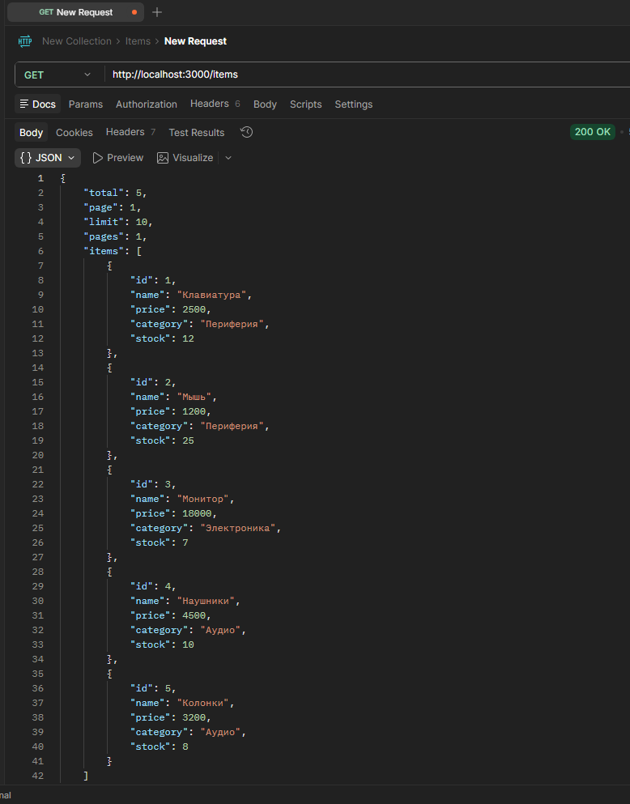

### 6.2. Получение одного товара — GET

```http
GET http://localhost:3000/items/2
```

Ожидаемый результат: код `200 OK` и данные товара с ID `2`.

**Скриншот 3 — GET /items/2: получение одного товара**

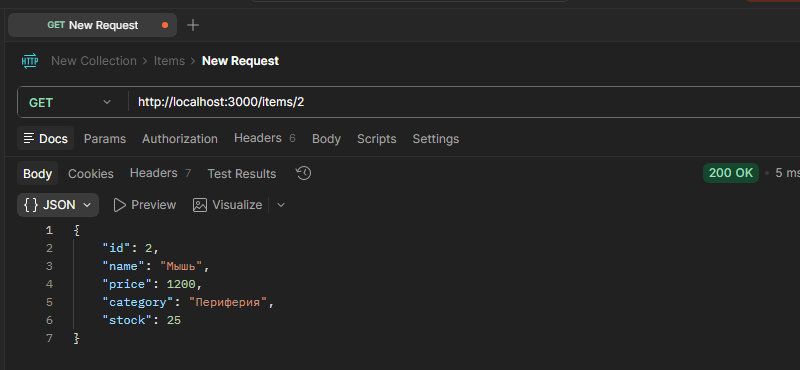

### 6.3. Создание товара — POST

```http
POST http://localhost:3000/items
Content-Type: application/json
```

```json
{
  "name": "Веб-камера",
  "price": 3900,
  "category": "Периферия",
  "stock": 6
}
```

Ожидаемый результат: код `201 Created` и объект созданного товара с новым ID.

**Скриншот 4 — POST /items: создание товара**

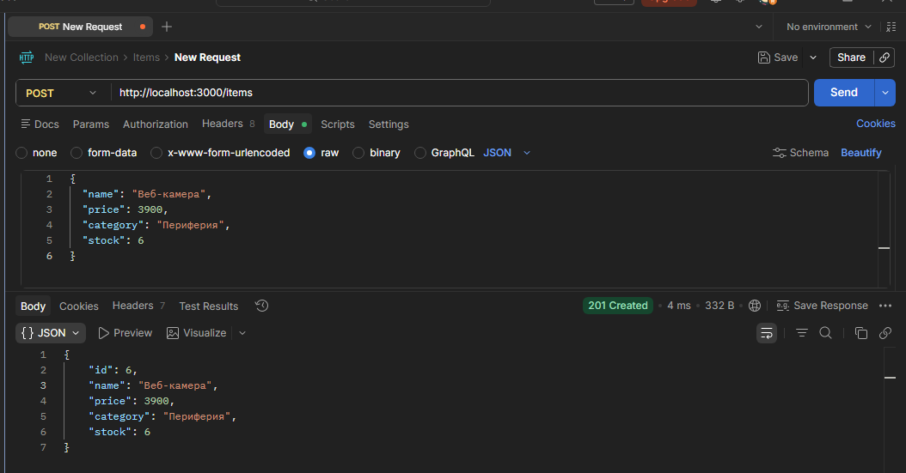

### 6.4. Обновление товара — PUT

```http
PUT http://localhost:3000/items/1
Content-Type: application/json
```

```json
{
  "name": "Механическая клавиатура",
  "price": 5200,
  "category": "Периферия",
  "stock": 9
}
```

Ожидаемый результат: код `200 OK` и обновлённый объект товара.

**Скриншот 5 — PUT /items/1: обновление товара**

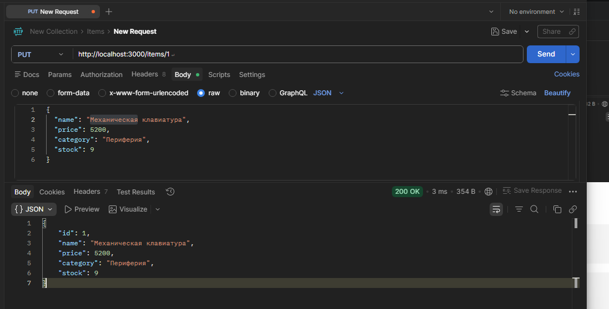

### 6.5. Удаление одного товара — DELETE

```http
DELETE http://localhost:3000/items/5
```

Ожидаемый результат: код `204 No Content`, тело ответа отсутствует.

**Скриншот 6 — DELETE /items/5: удаление товара**

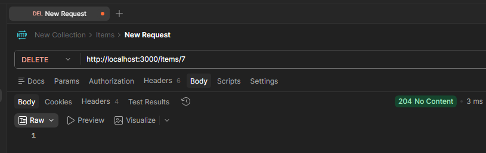

### 6.6. Валидация данных — ошибка 400

```http
POST http://localhost:3000/items
Content-Type: application/json
```

```json
{
  "name": "",
  "price": "дорого",
  "category": "Электроника",
  "stock": -2
}
```

Ожидаемый результат: код `400 Bad Request`, поскольку название пустое, цена имеет неверный тип, а остаток не может быть отрицательным целым числом.

**Скриншот 7 — Ошибка 400 при некорректных данных**

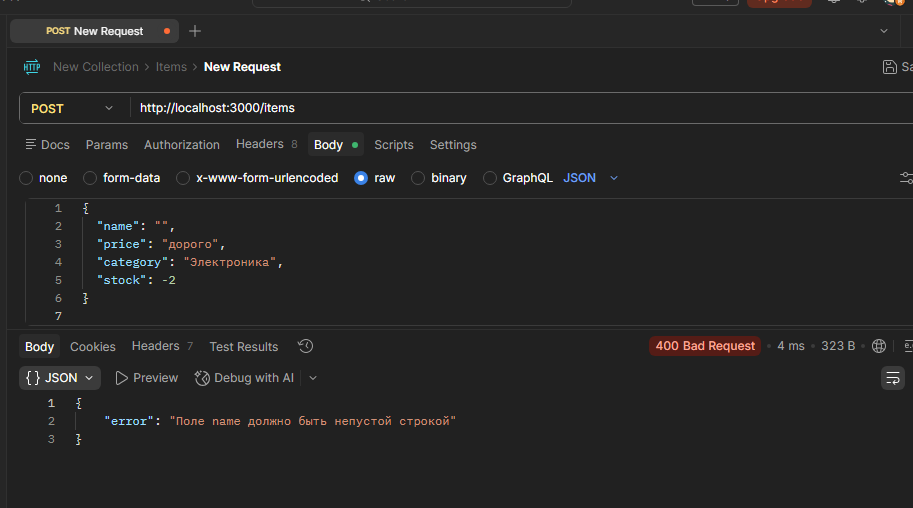

### 6.7. Обработка отсутствующего товара — ошибка 404

```http
GET http://localhost:3000/items/9999
```

Ожидаемый результат: код `404 Not Found` и JSON с описанием ошибки.

**Скриншот 8 — Ошибка 404: товар не найден**

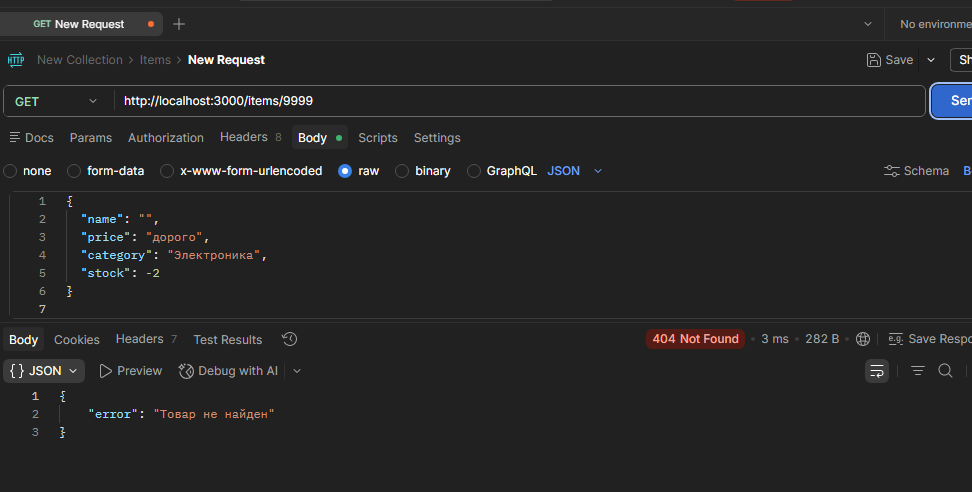

### 6.8. Поиск по названию

```http
GET http://localhost:3000/items?search=мышь
```

Ожидаемый результат: код `200 OK`, в списке остаются товары, название которых содержит строку поиска без учёта регистра.

**Скриншот 9 — Поиск товаров по названию**

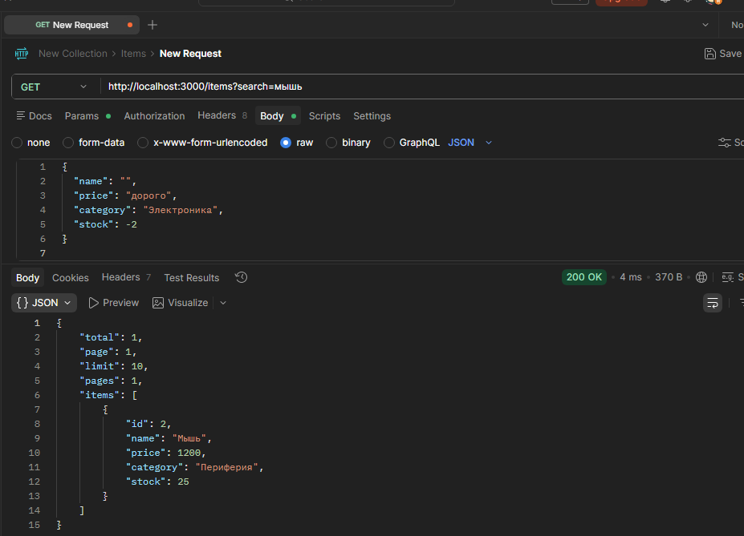

### 6.9. Сортировка

```http
GET http://localhost:3000/items?sort=price&order=desc
```

Ожидаемый результат: товары отсортированы по цене по убыванию.

**Скриншот 10 — Сортировка товаров по цене**

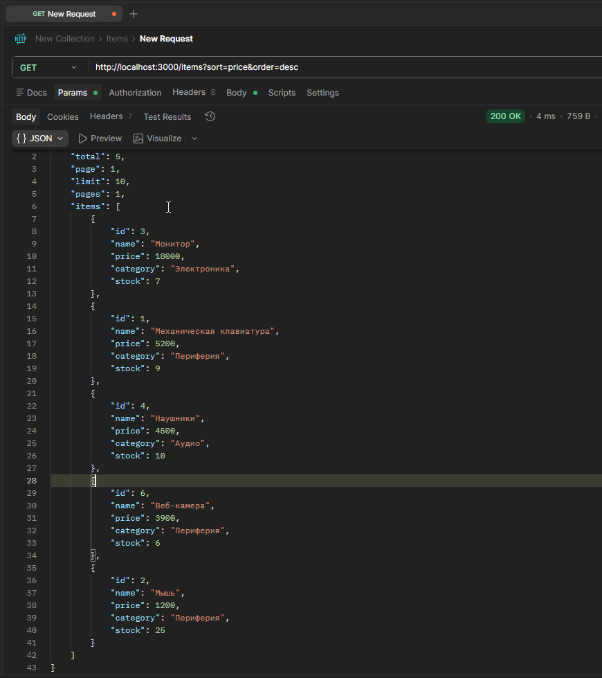

### 6.10. Пагинация

```http
GET http://localhost:3000/items?page=1&limit=2
```

Ожидаемый результат: возвращаются первые два товара и метаданные пагинации.

**Скриншот 11 — Пагинация списка товаров**

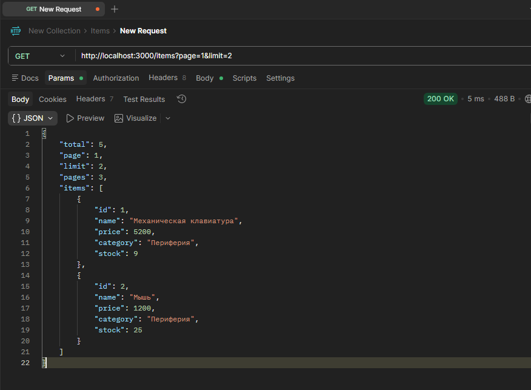

### 6.11. Частичное обновление — PATCH

```http
PATCH http://localhost:3000/items/2
Content-Type: application/json
```

```json
{
  "price": 1450
}
```

Ожидаемый результат: код `200 OK`; цена изменяется, остальные поля товара сохраняются.

**Скриншот 12 — PATCH /items/2: частичное обновление товара**

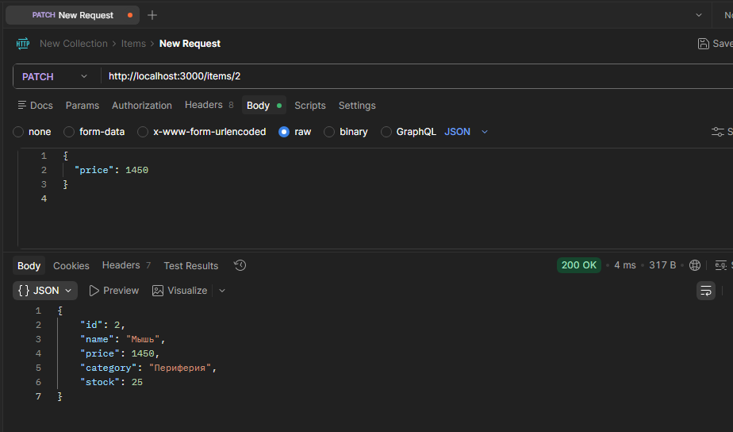

### 6.12. Массовое создание товаров

```http
POST http://localhost:3000/items/bulk
Content-Type: application/json
```

```json
{
  "items": [
    {
      "name": "USB-хаб",
      "price": 1600,
      "category": "Периферия",
      "stock": 14
    },
    {
      "name": "Микрофон",
      "price": 6100,
      "category": "Аудио",
      "stock": 4
    }
  ]
}
```

Ожидаемый результат: код `201 Created`, число созданных товаров и массив созданных объектов. Если хотя бы один элемент некорректен, запрос отклоняется с кодом `400`.

**Скриншот 13 — POST /items/bulk: массовое создание**

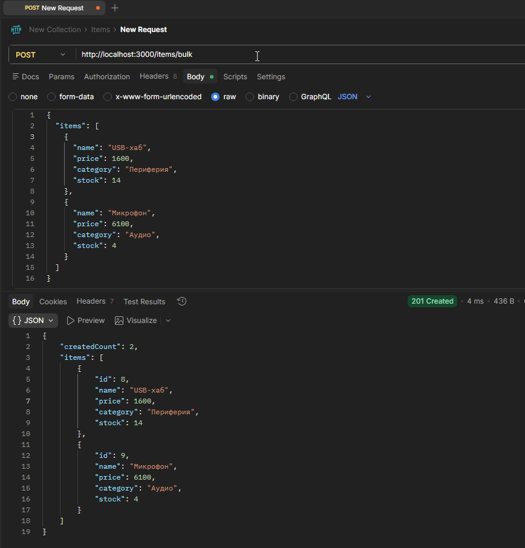

### 6.13. Массовое удаление товаров

```http
DELETE http://localhost:3000/items
```

Ожидаемый результат: код `200 OK`, сообщение об удалении и число удалённых элементов.

**Скриншот 14 — DELETE /items: массовое удаление**

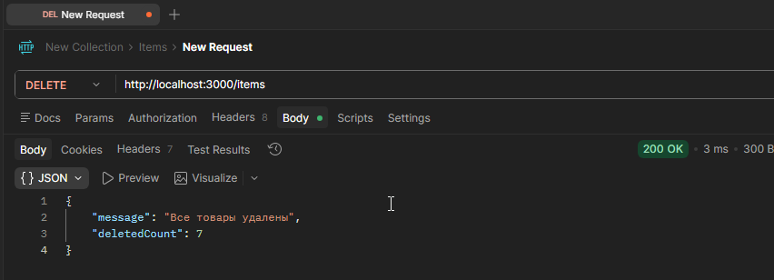

### 6.14. Статистика товаров

```http
GET http://localhost:3000/items/stats
```

Ожидаемый результат: код `200 OK`, количество товаров и средняя цена. Средняя цена рассчитывается как сумма цен всех товаров, делённая на их количество. Если товаров нет, средняя цена равна нулю.

**Скриншот 15 — GET /items/stats: статистика**

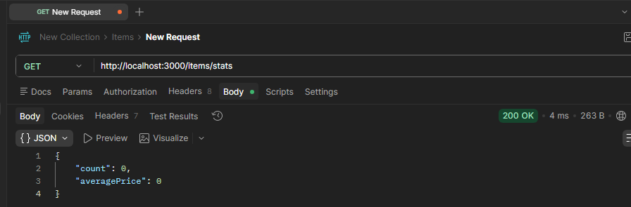

### 6.15. Связанные товары

```http
GET http://localhost:3000/items/1/related
```

Ожидаемый результат: код `200 OK`, список товаров той же категории, что и товар с ID `1`, без включения исходного товара.

**Скриншот 16 — GET /items/1/related: связанные товары**

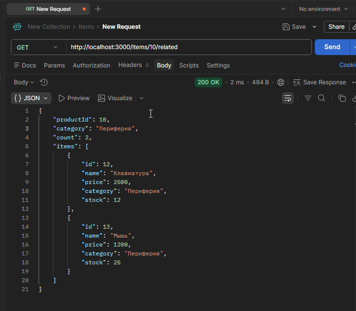

### 6.16. Проверка логирования

После выполнения запросов в корневой папке проекта должен появиться файл `access.log`. Каждая строка содержит дату и время, HTTP-метод, URL и статус ответа.

**Скриншот 17 — Файл access.log с записями запросов**

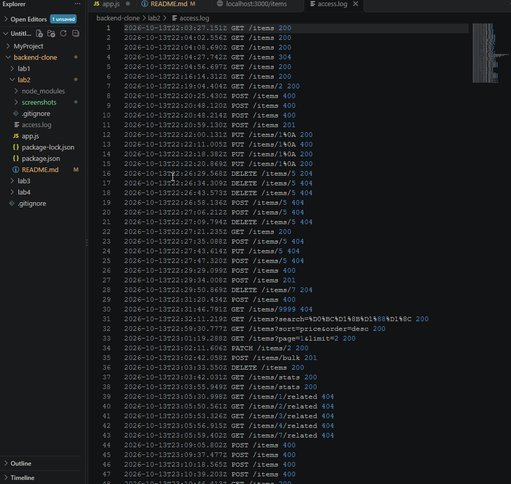

### 6.17. Обработка несуществующего маршрута

```http
GET http://localhost:3000/unknown
```

Ожидаемый результат: код `404 Not Found` и сообщение `Маршрут не найден`.

**Скриншот 18 — Обработка несуществующего маршрута**

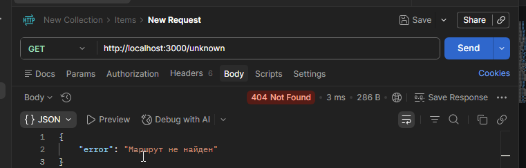


## 7. Дополнительные возможности и обработка ошибок

В индивидуальном задании реализованы следующие возможности:

1. **PATCH `/items/:id`** — частичное обновление выбранных полей товара.
2. **DELETE `/items`** — удаление всех товаров.
3. **POST `/items/bulk`** — создание нескольких товаров за один запрос.
4. **GET `/items/stats`** — получение количества товаров и средней цены.
5. **GET `/items/:id/related`** — получение товаров той же категории.
6. **Логирование** — запись HTTP-метода, URL и кода ответа в `access.log`.
7. **Глобальная обработка ошибок** — возврат `500 Internal Server Error` для непредвиденных ошибок.
8. **Валидация** — проверка названия, цены, категории, остатка и допустимых полей.
9. **Поиск, сортировка и пагинация** — параметры `search`, `sort`, `order`, `page` и `limit`.
10. **Ограничение размера тела запроса** — JSON-тело ограничено 100 КБ, а массовое создание ограничено 100 товарами.

Маршрут `/items/stats` и маршруты со статическими частями объявлены до `/items/:id`, чтобы они обрабатывались как предназначено. Ошибки валидации возвращаются с кодом `400`, отсутствие товара — с кодом `404`, а непредвиденные ошибки передаются глобальному обработчику.

## 8. Ответы на контрольные вопросы продвинутого уровня


### 1. Как реализовать частичное обновление (PATCH)?

В обработчике `PATCH /items/:id` нужно найти товар по ID, проверить переданные поля и изменить только те свойства, которые присутствуют в теле запроса. Остальные свойства сохраняются без изменений.

### 2. Как реализовать массовое удаление элементов?

Создать маршрут `DELETE /items`, который удаляет всю коллекцию. В данной работе перед очисткой фиксируется количество элементов, затем массив заменяется пустым массивом, а сервер возвращает число удалённых товаров.

### 3. Как реализовать массовое создание элементов?

Создать маршрут, например `POST /items/bulk`, который принимает массив объектов. Перед добавлением нужно проверить, что массив непустой, ограничить количество элементов и проверить каждый объект. После успешной проверки элементам назначаются уникальные ID, затем они добавляются в коллекцию.

### 4. Как реализовать глобальный обработчик ошибок?

В Express глобальный обработчик ошибок объявляется после маршрутов и middleware. Он имеет четыре параметра: `(err, req, res, next)`. Обработчик записывает информацию об ошибке в журнал и возвращает ответ с кодом `500`, если заголовки ответа ещё не отправлены.

### 5. Как логировать запросы в файл?

Можно использовать middleware, который получает метод и URL запроса, а после завершения ответа записывает их вместе с временем и статус-кодом в файл. В данной работе для записи применяется `fs.appendFile()` и файл `access.log`.

### 6. Что такое REST API и какие принципы лежат в его основе?

REST API — интерфейс взаимодействия с ресурсами через HTTP. Основные принципы REST включают клиент-серверное разделение, отсутствие хранения состояния клиентской сессии между запросами на стороне сервера, единообразный интерфейс, ресурсы с идентификаторами и использование стандартной семантики HTTP. В этой работе товары представлены ресурсом `/items`, а операции выполняются HTTP-методами.

### 7. Как организовать структуру проекта для масштабируемого CRUD API?

По мере роста приложения код целесообразно разделять на маршруты, контроллеры, сервисы бизнес-логики, слой доступа к данным, middleware валидации и обработки ошибок, а также конфигурацию. Это упрощает тестирование и сопровождение. В данной лабораторной работе код находится в одном файле `app.js` для наглядности.

### 8. Какие существуют стратегии генерации уникальных ID?

Можно использовать последовательный счётчик, UUID, идентификаторы, генерируемые базой данных, или специальные распределённые алгоритмы. В данной работе применяется последовательный счётчик `nextId`. В реальном многопользовательском приложении необходимо учитывать параллельное создание ресурсов и перезапуск сервера.

### 9. Как защитить API от слишком больших запросов?

Следует ограничивать размер тела запроса, например через `express.json({ limit: '100kb' })`, ограничивать размер массивов в массовых операциях, проверять входные данные и при необходимости применять rate limiting и аутентификацию. В этой работе настроено ограничение JSON-тела в 100 КБ и максимум 100 товаров в массовом запросе.

### 10. Как реализовать связь между сущностями (например, задачи и пользователи)?

Обычно одна сущность хранит идентификатор связанной сущности, например `userId`. При запросе сервер находит связанные записи и возвращает их в ответе. Для товаров в данной работе роль связи демонстрирует маршрут `/items/:id/related`, который находит товары той же категории.

## 9. Вывод

В ходе лабораторной работы создан REST-подобный API на Express.js для управления товарами. Реализованы основные CRUD-операции, проверка входных данных, поиск по названию, сортировка, пагинация и корректные коды HTTP-ответов. Для продвинутого уровня добавлены частичное обновление, массовое создание и удаление, статистика, поиск связанных товаров, логирование запросов в файл и глобальный обработчик ошибок.

В результате изучены принципы обработки HTTP-методов и организации API-маршрутов. Поскольку данные хранятся в оперативной памяти, они сбрасываются при перезапуске сервера; для постоянного хранения в реальном приложении потребуется база данных.

## 10. Список использованных источников

1. Методические указания к лабораторной работе № 2 «HTTP-методы: обработка GET, POST, PUT, DELETE».
2. Express — Routing: https://expressjs.com/en/guide/routing.html
3. Express — Request и Response API: https://expressjs.com/en/4x/api.html
4. MDN Web Docs — HTTP request methods: https://developer.mozilla.org/ru/docs/Web/HTTP/Methods
5. MDN Web Docs — HTTP response status codes: https://developer.mozilla.org/ru/docs/Web/HTTP/Status
6. REST API Tutorial: https://restfulapi.net/
7. Postman Learning Center: https://learning.postman.com/
8. Thunder Client: https://www.thunderclient.com/
